# Tonearm

A now-playing overlay for OBS Studio on Windows. Tonearm reads what Apple Music, Spotify and other players report to Windows, and draws the title, artist, album, artwork and progress as a native OBS source, with four designed looks to choose from.

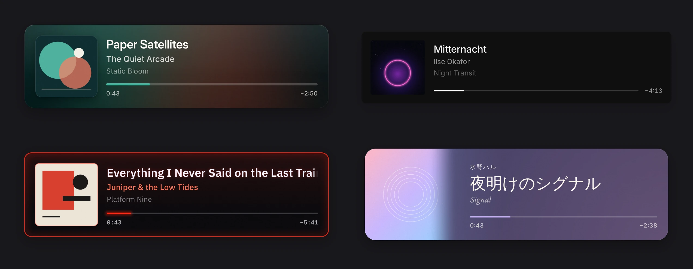

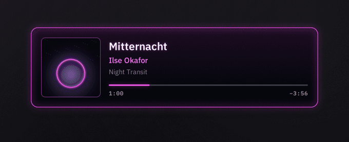

> **Status: 0.1.0, pre-release.** The rendering, layouts, settings and OBS integration run and are tested inside OBS. The Windows media connection (SMTC) is written but has not yet been run on a Windows machine. See [what has been verified](docs/testing.md) before relying on it for a stream.

## What it does

- **Finds your music automatically.** Tonearm listens to the Windows media controls, the same feed that drives the volume flyout and lock screen. Apple Music, Spotify, TIDAL, Deezer, Amazon Music, foobar2000, MusicBee, VLC and Media Player all report there. No accounts, API keys, browser sources or web services are involved.
- **Four presets that differ in more than color.** Glass, Minimal, Neon and Editorial each have their own typography, surface treatment and motion.
- **Four layouts.** Compact and expanded horizontal bars, a square card and a vertical card. Each one rearranges its content to fit the size you give it.
- **Colors from the artwork.** The accent and background tint come from the album art. Text and accent colors are checked against the actual background and adjusted to stay readable.
- **Accurate progress.** Players only report their position occasionally, so Tonearm extrapolates between reports and glides across seeks instead of jumping.
- **Considered motion.** Track changes, artwork arriving late, pausing and resuming each have their own transition. Long titles scroll with soft edges. A reduced-motion option swaps all movement for short crossfades.
- **Playback states.** Playing, paused (dim, keep, or hide after a delay), nothing playing (hide or show a message) and player closed are all handled.
- **Choose which player wins.** Automatic selection, a preferred order, or a strict allow list. Browsers are excluded by default because they also report videos and ads.
- **Presets as files.** Export your settings to a JSON file and import them into another scene or another PC.
- **Light on OBS.** Text and surfaces are rendered on a background thread only when something changes. Each frame the GPU just composites a handful of textures. When the source isn't visible in any scene, it skips rendering entirely.

## Presets

| | Compact | Expanded | Square | Vertical |
|---|---|---|---|---|
| **Glass** frosted surface from a blurred copy of the artwork | 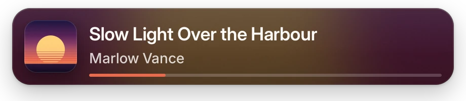 | 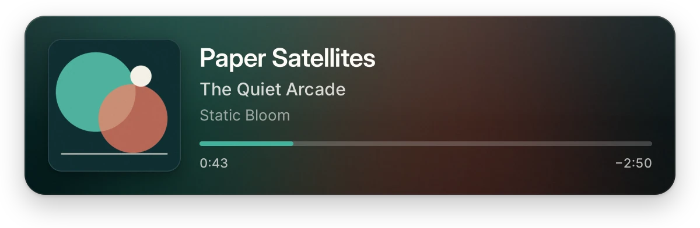 | 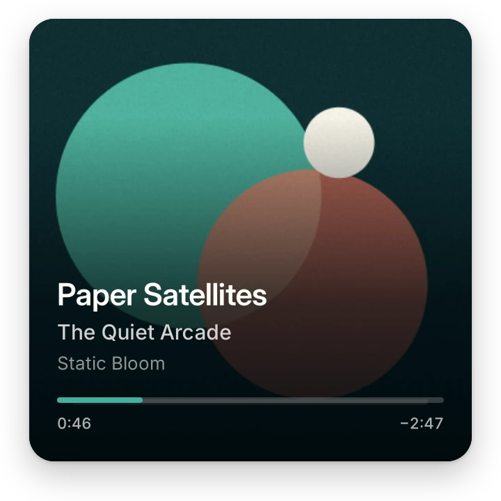 | 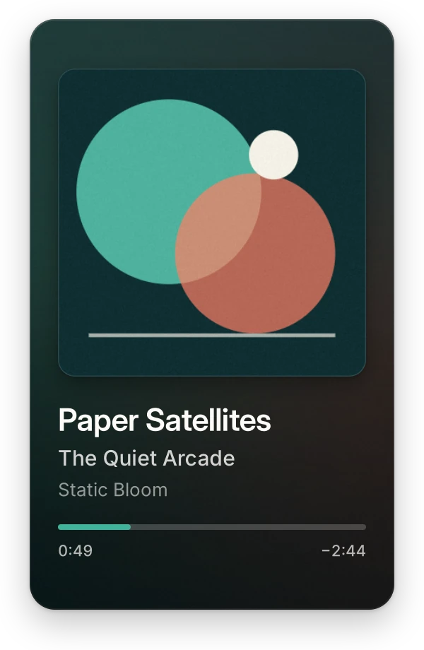 |
| **Minimal** flat, quiet, remaining time only | 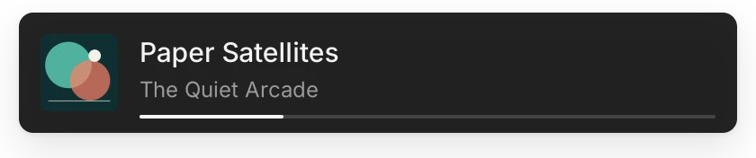 | 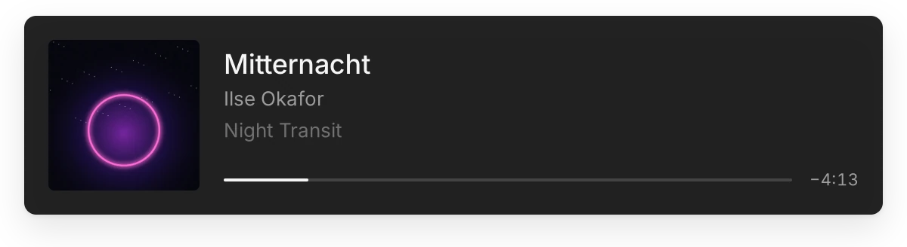 | 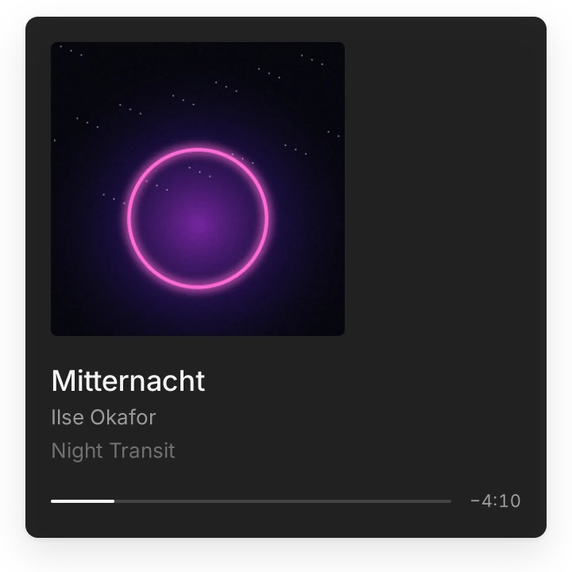 | 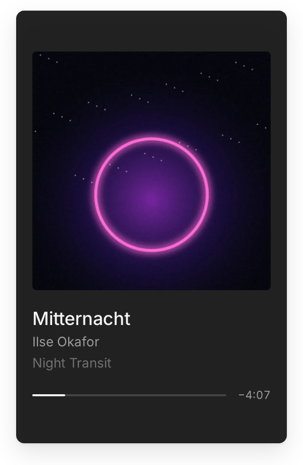 |
| **Neon** dark glass, glowing edge and progress | 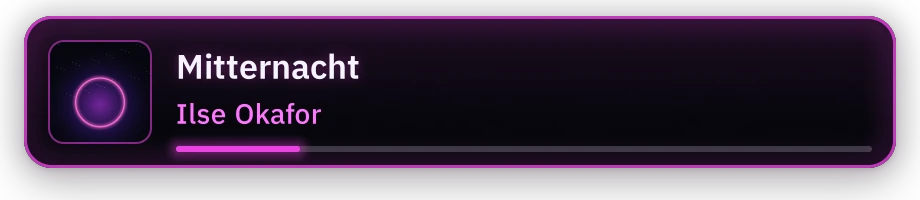 | 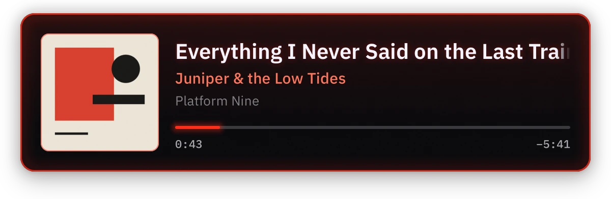 | 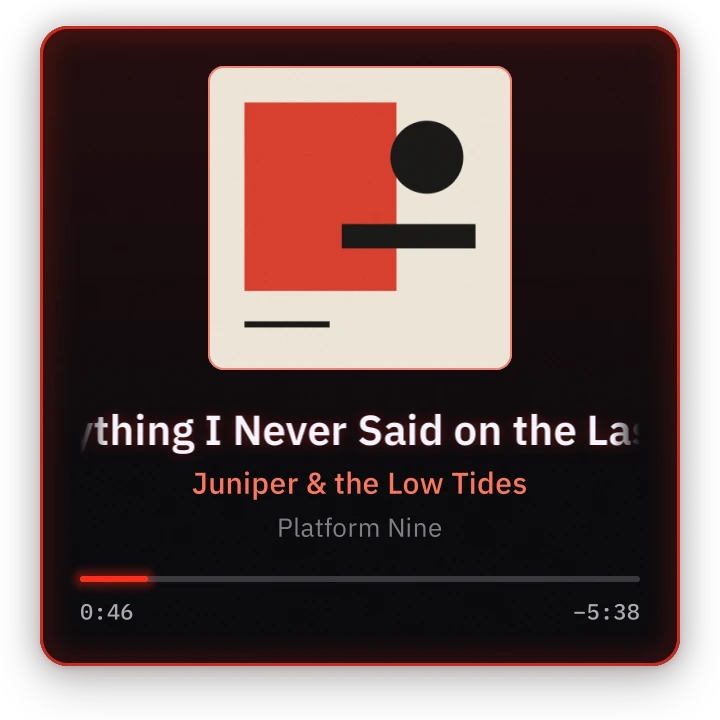 | 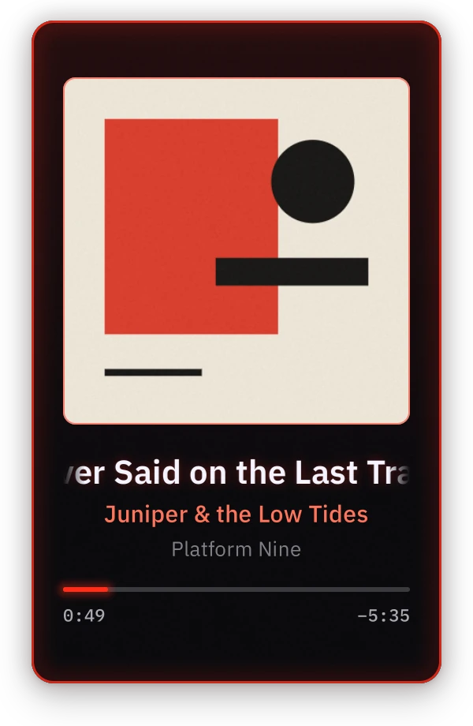 |
| **Editorial** serif title, full-bleed artwork | 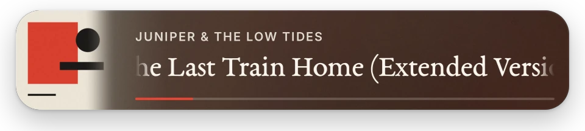 | 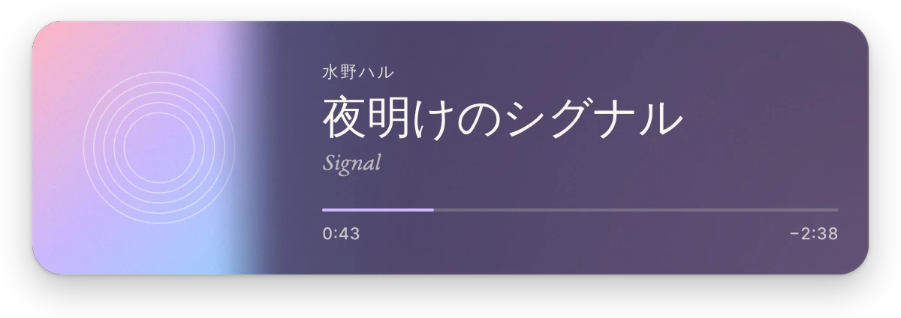 | 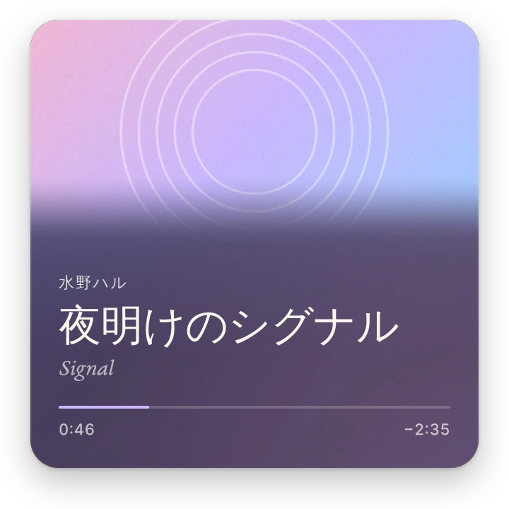 | 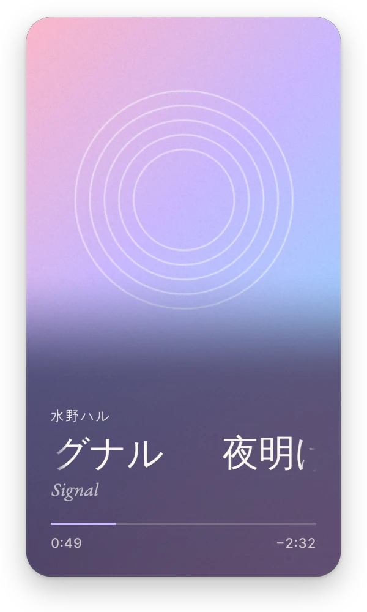 |

All of these are screenshots of the Tonearm source in OBS Studio, captured at 2× using the built-in sample tracks. The sample songs, artists and covers are invented and generated by Tonearm itself. A few titles were mid-scroll when captured. The animation above was rendered frame by frame with `tonearm-render`, a headless tool in this repository that drives the same scene and rasterizer code as the plugin.

## Install

1. Download `tonearm-<version>-windows-x64.zip` from the [Releases](../../releases) page.
2. Close OBS.
3. Extract the zip into your OBS installation folder, usually `C:\Program Files\obs-studio`. It adds `obs-plugins\64bit\tonearm.dll` and `data\obs-plugins\tonearm\`.
4. Start OBS, click **+** under Sources and add **Tonearm Now Playing**.

To remove it, delete those two items again. [Getting started](docs/getting-started.md) has the full steps, plus an alternative location under `C:\ProgramData` that keeps Tonearm separate from OBS's own files.

## Requirements

| | |
|---|---|
| Windows | Windows 10 version 1809 or newer, or Windows 11 (64-bit) |
| OBS Studio | 30.2 or newer, 64-bit |
| Players | Anything that shows up in the Windows media flyout. Apple Music (Microsoft Store app), Spotify, TIDAL, Deezer, Amazon Music, foobar2000, MusicBee, VLC and Media Player are recognised by name. |
| Linux, macOS | The plugin builds and runs, but there is no media connection yet, so it only shows sample tracks. Useful for development, not for streaming. |

## Settings at a glance

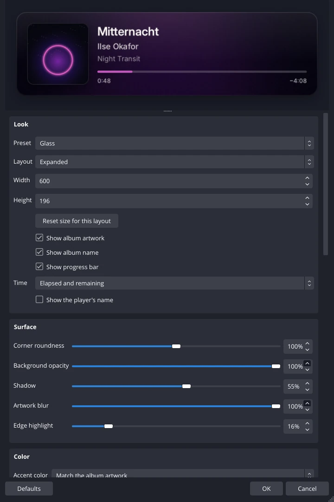

Settings are grouped into Look, Surface, Color, Typography, Motion, Playback states, Music sources and Preset files, and the OBS properties window previews every change live. Switch on **Show sample tracks when nothing is playing** while you design the scene, then switch it off before going live. Every option is described in the [settings reference](docs/settings.md).

## How it compares

Tonearm was started after looking closely at [OBSSpotifyPlugin](https://github.com/lingeriegoat/OBSSpotifyPlugin) by lingeriegoat, a native SMTC plugin licensed under the GPL. No code was taken from it. The table describes design choices rather than a ranking; the OBSSpotifyPlugin column is based on the settings and files in its 2.9 release.

| | Tonearm | OBSSpotifyPlugin 2.9 | Browser-source widgets |
|---|---|---|---|
| Runs inside OBS without a browser source | Yes | Yes | No |
| Needs an account or API key | No | No | Usually (Spotify Web API, Last.fm) |
| Music sources | Windows media controls | Windows media controls | Usually one service |
| Rendering | Layers rasterized off-thread on change, composited on the GPU each frame | GDI+ drawing into a texture | Chromium |
| Looks | 4 presets, each with 4 layouts | One card with horizontal or vertical layout, plus VHS, 8 mm, glitch, duotone and black-and-white effects | Varies |
| Text outlines and per-line spacing controls | No | Yes | Varies |
| Readability adjustment against the artwork | Yes (WCAG AA) | Not in its settings | Varies |
| Reduced-motion option | Yes | Not in its settings | Varies |
| Audio meter | No, since Windows media controls carry no audio | VU meter with a randomness setting | Varies |

## Limitations

These are deliberate or come from what Windows provides. They are explained in more detail in [Troubleshooting](docs/troubleshooting.md).

- **No audio visualizer.** The Windows media controls carry metadata only, not audio. A visualizer that moved without real audio would be decoration pretending to be data, so Tonearm doesn't draw one. A proper version would read an OBS audio source; that is not implemented.
- **Position is extrapolated.** Players report their position on seeks and state changes, not continuously. Tonearm counts forward between reports, which is accurate to about a second. If a player stops reporting during playback, the bar can drift until its next report.
- **Some players report no duration.** In that case Tonearm hides the progress bar and times rather than guessing.
- **Artwork resolution is up to the player.** Some players hand Windows a small thumbnail. Tonearm upscales it smoothly, but it can look soft on large layouts.
- **Apple Music combines artist and album** into one field (`Artist — Album`). Tonearm splits it back apart, which can misfire if an artist name itself contains ` — `.
- **No playback controls.** Tonearm displays what's playing; it doesn't play, pause or skip.
- **Windows only for live data.** Linux (MPRIS) and macOS support are not written yet.

## Building from source

```sh
cmake -S . -B build -DTONEARM_BUILD_TESTS=ON
cmake --build build --config RelWithDebInfo
ctest --test-dir build -C RelWithDebInfo
```

Windows needs Visual Studio 2022 with the Windows 10 or 11 SDK and a libobs SDK. Linux needs `libobs-dev` and `libpango1.0-dev`. The full instructions, including how CI builds the libobs SDK, are in [Building](docs/building.md). How the pieces fit together is in [Architecture](docs/architecture.md).

## Documentation

- [Getting started](docs/getting-started.md)
- [Settings reference](docs/settings.md)
- [Troubleshooting and FAQ](docs/troubleshooting.md)
- [Architecture](docs/architecture.md)
- [Building](docs/building.md)
- [Testing and verification status](docs/testing.md)
- [Changelog](CHANGELOG.md)

## License and credits

Tonearm is free software under the GNU General Public License, version 2 or (at your option) any later version. See [LICENSE](LICENSE).

It bundles Inter, IBM Plex Sans, IBM Plex Mono and EB Garamond under the SIL Open Font License 1.1. Their copyright notices are in [NOTICE.md](NOTICE.md) and [data/fonts](data/fonts/README.md). Thanks to lingeriegoat for OBSSpotifyPlugin, which showed that a native SMTC overlay for OBS was worth doing well.

Apple Music, Spotify and other product names belong to their owners. Tonearm is not affiliated with or endorsed by any of them, or by the OBS Project.
