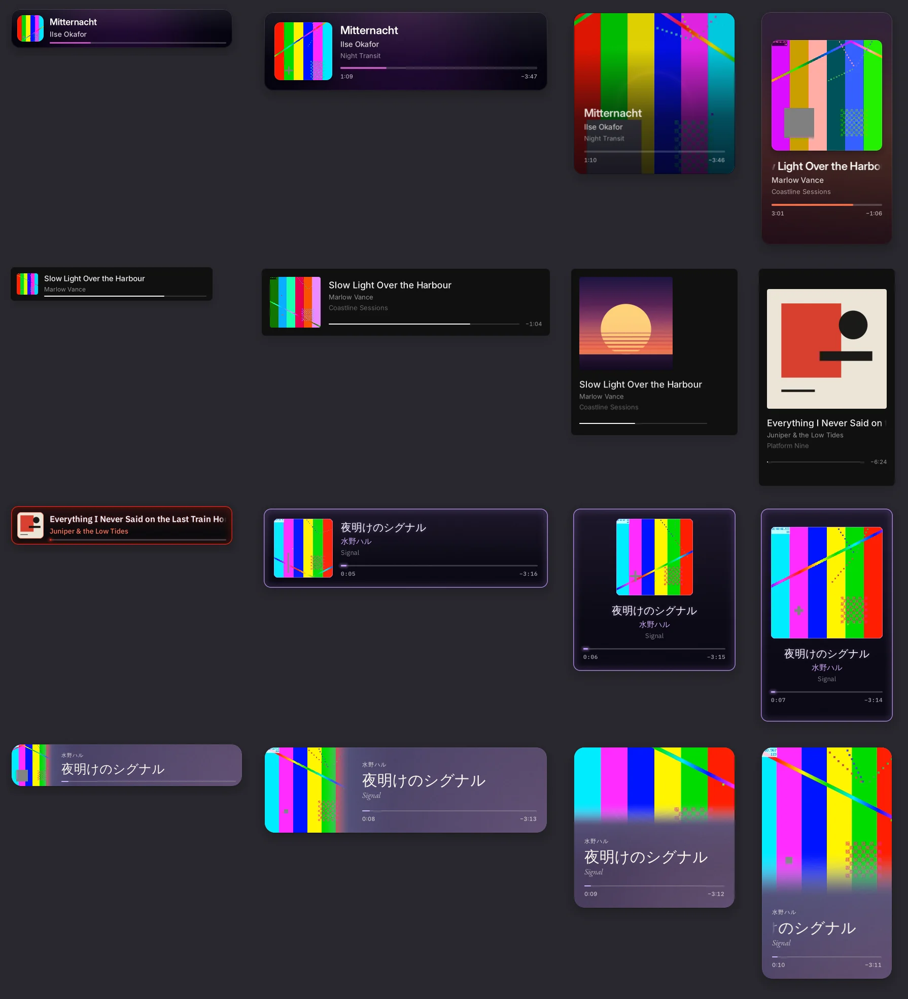

# Animated artwork (experimental)

Tonearm can play a looping video in place of the still album cover. The video sits in the same place as the cover, with the same mask, in every preset and layout. When no video is available, or anything goes wrong, Tonearm shows the still cover as it always has.

The feature is **off by default**. While it is off, Tonearm creates no media decoder, starts no extra thread and reads no extra files.



*The covers in this image are FFmpeg test patterns, not album artwork. They were captured from OBS Studio 30.0.2 on Linux while the scripted test player was running.*

## Where the videos come from

In this version the videos come from **a folder you choose**. Tonearm downloads nothing.

Name each file after the release:

```
Phoebe Bridgers - Punisher.mp4          square artwork
Phoebe Bridgers - Punisher [tall].mp4   portrait (3:4) artwork
Fleetwood Mac - Rumours (Super Deluxe).mp4
Phoebe Bridgers - Kyoto - Single.mp4
```

Supported files are `.mp4`, `.m4v`, `.mov`, `.webm`, `.mkv` and `.m3u8` (an HLS playlist with its segments next to it, including fragmented-MP4 HLS). New files are picked up within about ten seconds.

### Why Tonearm doesn't fetch Apple Music's videos

Apple Music shows motion artwork for some albums. The public Apple Music API doesn't provide it: the documented album attributes include only a still `artwork` field, and an Apple engineer said on the developer forums that this data "is not made available by Apple Music API for third-party apps" ([forum thread](https://developer.apple.com/forums/thread/696843)).

[CoverPy](https://github.com/matteing/coverpy) shows that the videos can be reached anyway. Its experimental `motion.py`:

1. loads an album page on music.apple.com,
2. downloads the web player's JavaScript bundle,
3. extracts the web player's own sign-in token (a JWT issued to `AMPWebPlay`) from it,
4. calls Apple's private catalog API (`amp-api.music.apple.com`) with that token and an `Origin: https://music.apple.com` header, asking for the undocumented `editorialVideo` extension, and
5. reads the HLS playlists it returns.

Steps 3 and 4 sign in with a credential Apple issued to its own web player, and present the request as coming from Apple's website. That is getting past an authentication control rather than using a published interface, so Tonearm doesn't include it and won't ship it. The live test that would exercise it was not run. Separately:

- Apple's [Developer Program License Agreement](https://developer.apple.com/support/terms/apple-developer-program-license-agreement/), section 3.3.6(D), covers MusicKit and the Apple Music API. It forbids calling them "for purposes unrelated to facilitating access to Your end users' Apple Music subscriptions", forbids modifying MusicKit content, and says album art from the API "may not be used separately from music playback or managing playlists". So a developer token of your own doesn't make this permitted either. Tonearm only shows what another app is playing, and it masks and tints the artwork.
- Apple's website terms prohibit automated scraping of its sites.
- Motion artwork is copyrighted promotional material supplied by labels. Tonearm never bundles any.

**What would change this:** Apple documenting motion artwork in the Apple Music API with terms that allow display in a now-playing overlay. The code is ready for that: video sources plug into `MotionSource` (see [Architecture](architecture.md#animated-artwork)), and everything after "here is a video for this release" is shared.

### Notes from reviewing CoverPy

- CoverPy's 75 offline tests pass (Python 3.13, mocked HTTP). They prove its parsing, not that Apple's service currently answers.
- For a playlist with a separate initialization segment (`#EXT-X-MAP:URI="init.mp4"`), CoverPy's "direct MP4" is that initialization segment. It holds no frames and can't be played on its own. This was reproduced with a locally generated fragmented-MP4 HLS stream: CoverPy returned `signal-init.mp4`, which has no video frames, while the playlist itself decoded to 120 frames. CoverPy's test fixtures use the byte-range layout (`BYTERANGE="897@0"`), where the URI names one file that holds the initialization data and every fragment, so it can be played as a whole. Which layout Apple serves wasn't checked, because the live endpoint wasn't called. Tonearm plays the HLS playlist itself through FFmpeg, which handles both layouts.
- No CoverPy code is included in Tonearm. CoverPy is MIT-licensed, which is compatible with Tonearm's GPL-2.0-or-later, so reusing its code would only have needed its copyright notice kept.

## Settings

The settings are in **Animated artwork (Experimental)** in the source properties.

| Setting | What it does |
|---|---|
| **Artwork** | *Static artwork* (default) or *Animated artwork when available*. |
| **Preferred orientation** | *Automatic* uses portrait videos for tall artwork areas and square ones otherwise. *Square* and *Portrait* force a choice. If only one shape exists, it is used, center-cropped to fit. |
| **When music pauses** | *Pause the animation* (default) freezes the current frame. *Keep looping* doesn't. |
| **Animated artwork folder** | The folder to read videos from. |

**Reduce motion** in the Motion group always shows the still cover. There is no quality setting: Tonearm copies frames at the size the artwork is drawn, and never above the video's own resolution.

## How it behaves

| Situation | Result |
|---|---|
| A video matches the playing release | The video fades in over the still cover (460 ms) and loops |
| No matching file, or the match is uncertain | Still cover |
| File can't be opened or decoded | Still cover (OBS logs `MP: Failed to open media`) |
| Track changes | The old video is dropped at once (the still cover underneath matches it), then the new one fades in when its first frame is decoded. A stale frame from the previous video is never shown |
| Next track from the same album | The same video keeps playing without restarting |
| Music paused | The video is dimmed like the still cover, using a tint so the cover underneath never shows through, and freezes unless *Keep looping* is on |
| Source not visible in any scene | Decoding is paused |
| Feature switched off | The decoder and its thread are destroyed, and the open file is closed |
| Sample tracks (*Show sample tracks when nothing is playing*) | Still covers only |

### Matching rules

A video is used only when the artist **and** the album match exactly after normalization. Normalization ignores case, accents, apostrophes and punctuation, and treats `&` as "and". Edition qualifiers must match too:

- *Midnights* and *Midnights (3am Edition)* are different releases.
- *Rumours* and *Rumours (Super Deluxe)* are different releases.
- *Kyoto - Single* and *Kyoto* are different releases.
- *Wish You Were Here* and *Wish You Were Here (2011 Remastered Version)* are different releases.
- "Deluxe" and "Deluxe Edition" count as the same qualifier.

Artist matching also accepts the album artist and the first artist of a credit like "A & B" or "A feat. B". If two different files claim the same release and shape, neither is used.

## Performance

These numbers come from OBS Studio 30.0.2 on a 4-core Linux container. It has **no GPU**, so all rendering is software OpenGL and decoding is software only. Rendering work that a graphics card would do shows up here as CPU time, so read the numbers as an upper bound for this machine, not a prediction for Windows. Each figure is OBS's whole-process CPU over 48 seconds of the scripted player, at 1280×720 and 30 fps, with a 720×720 H.264 test video at 30 fps.

| Configuration | OBS process CPU (% of one core) |
|---|---|
| No Tonearm source | 21.1 |
| Tonearm, static artwork | 30.3 |
| Tonearm, animated artwork | 58.1 |
| Animated artwork switched back off | 30.8 |
| Animated artwork on, Tonearm not in the live scene | 20.6 |

Decoding that video alone takes about 7% of one core. The rest of the difference is software rendering: OBS's color conversion of each new frame, Tonearm's copy into its artwork texture, and the masked draw. On a graphics card these are small GPU passes, and OBS's media source uses hardware decoding where it's available (D3D11VA on Windows). Memory rose by about 2 MB.

The design choices that keep the cost down:

- Each video is decoded once, by OBS's own media source, however many times Tonearm is drawn.
- Tonearm copies at most 30 frames a second, at the artwork's on-screen size, into one reused texture. Only the cropped part of the frame is copied.
- No copies happen while the still cover is shown, and decoding is paused while the source is hidden.
- File lookups run on their own thread, never on OBS's graphics or UI threads.

GPU load, encoder impact and hardware decoding on Windows still need measuring on a real PC (see [Testing](testing.md#animated-artwork)).

## Privacy and network

With the version in this branch, Tonearm makes **no network requests**, whether or not the feature is on. It reads the folder you choose, and nothing else.
