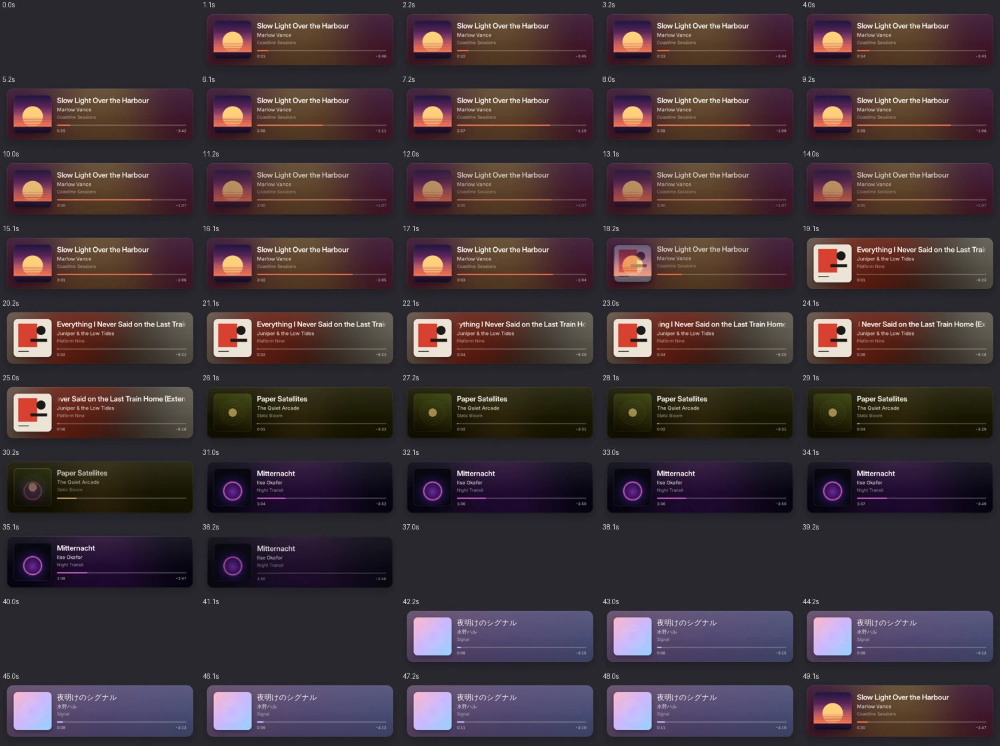

# Testing and verification status

This page says plainly what has been checked, how, and what still needs a Windows machine. It is updated with each release.

## Status for 0.1.0

| Area | Status | How |
|---|---|---|
| Core: color, imaging, layout, rasterizer, scene | Verified | 48 unit tests, also run under AddressSanitizer and UndefinedBehaviorSanitizer with no findings in Tonearm code |
| Layout across presets, layouts, sizes and missing content | Verified | Geometry invariants checked for 4 presets × 4 layouts × 8 content combinations × several sizes and aspect ratios |
| Plugin loads, renders and shuts down in OBS | Verified on Linux | OBS Studio 30.0.2 on Linux (software OpenGL), screenshots through obs-websocket; shutdown log reports `Number of memory leaks: 0` |
| Settings window, live preview, every group | Verified on Linux | Opened in OBS 30.0.2 and inspected |
| Transitions, seek, pause/resume, long titles, missing artwork, player hand-off, idle | Verified on Linux with a scripted player | `TONEARM_SCRIPTED_MEDIA=1`, see below |
| Preset or layout changes through obs-websocket | Verified on Linux | All 16 combinations switched live during the gallery capture |
| DirectWrite text backend | Verified in unit tests on Windows | The 48 unit tests pass on the Windows CI runner (MSVC 19.44), where text shaping and rasterization go through DirectWrite with the bundled fonts. Not yet seen inside OBS on Windows |
| WIC artwork decoding | Compiles with MSVC; not yet run | Runs only when a player supplies artwork, so it needs a real Windows session |
| SMTC media connection (Apple Music, Spotify, others) | Compiles with MSVC; not yet run | Needs a real Windows session with players |
| Windows package layout | Produced by CI | The Windows job installs `obs-plugins\64bit\tonearm.dll` and `data\obs-plugins\tonearm\` and zips them, with debug symbols in a separate zip. Not yet installed into OBS on Windows |
| High-DPI | By design | OBS sources render in canvas pixels, not screen pixels. Tonearm scales everything from the source's width and height, so a larger source is rendered sharper rather than stretched. |

Until the Windows rows are checked, treat the Windows build as a preview.

## Windows test plan

Run in a portable OBS so an existing installation and its plugins stay untouched.

1. **Load**: the log shows `[tonearm] loaded version …` and `system media provider started`; no warnings from `tonearm`.
2. **Apple Music**: play, pause, resume, skip, seek by dragging the scrubber. Title, artist and album appear separately (the combined field is split). Artwork appears, also when it arrives a moment after the text. Progress stays within a second of Apple Music's own display for a whole track.
3. **Spotify**: same as above, plus an ad or a podcast episode if available.
4. **Switching players**: pause Apple Music and start Spotify; the overlay follows. With *Prefer the apps below* and Apple Music first, start both; Apple Music wins.
5. **Browsers**: play a YouTube video in Edge. Nothing shows until **Include web browsers** is ticked.
6. **No artwork**: a local file without embedded art in Media Player shows the generated cover.
7. **Closing the player** with each idle behavior: hide, and show a message.
8. **Long and non-Latin titles**: a long title scrolls; a Japanese or Korean title renders with the Windows fallback font.
9. **Resizing and scaling**: change width and height, switch every preset and layout, try 125% and 200% Windows display scaling.
10. **Load**: with the overlay visible, OBS's CPU usage and render time (Stats dock) change by less than a percent and well under a millisecond respectively. With the source in a hidden scene, Tonearm adds nothing measurable.
11. **Shutdown and restart**: close OBS while music plays; it exits promptly, the log shows `media provider stopped` and `Number of memory leaks: 0`. Restart and the overlay comes back with its settings.
12. **Hung player**: suspend the player process in Task Manager's details view (or Resource Monitor); OBS keeps rendering, and closes normally.

## In-OBS scenario run

The scripted player replays a fixed sequence in a loop. This contact sheet shows one loop captured once per second from OBS 30.0.2 on Linux, with the Glass preset:



| Time | Event | What to look for |
|---|---|---|
| 0 s | Apple Music starts playing | Card fades in |
| 6 s | Seek forward | Bar glides to the new position; times update |
| 10 s | Pause | Art and text dim, time stops |
| 14 s | Resume | Dimming lifts, time continues from where it stopped |
| 18 s | Next track with a long title | Crossfade with the Glass choreography, then the title scrolls with soft edges |
| 25 s | Track without artwork | Generated cover, palette from the track |
| 30 s | Spotify starts while Apple Music pauses | Hand-off to the playing player |
| 36 s | Both players close | Card fades out |
| 41 s | Playing again | Card fades back in with the new track |

## Running the tests

```sh
ctest --test-dir build --output-on-failure
./build/tonearm-tests layout      # only tests whose name contains "layout"
```

To run them with sanitizers on Linux:

```sh
cmake -S . -B build-asan -DCMAKE_BUILD_TYPE=Debug -DTONEARM_BUILD_PLUGIN=OFF \
  -DCMAKE_CXX_FLAGS="-fsanitize=address,undefined -fno-omit-frame-pointer"
cmake --build build-asan --target tonearm-tests && ./build-asan/tonearm-tests
```

LeakSanitizer reports allocations made by fontconfig when fonts are registered; those belong to fontconfig's process-wide cache.
